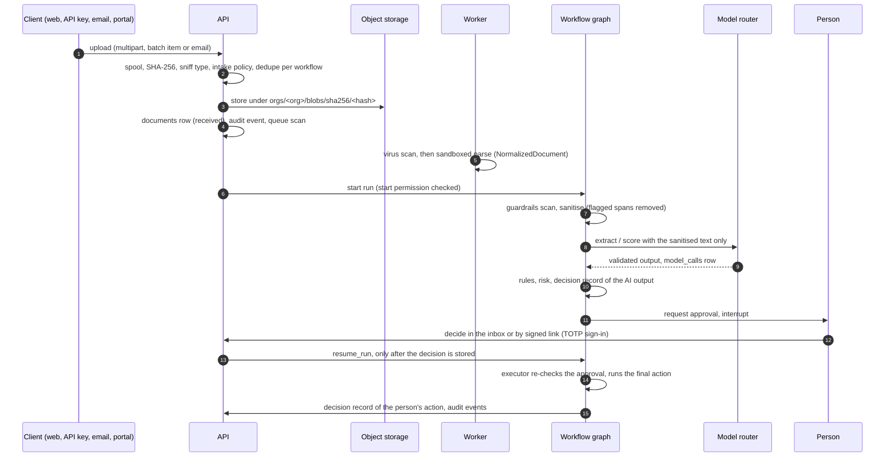
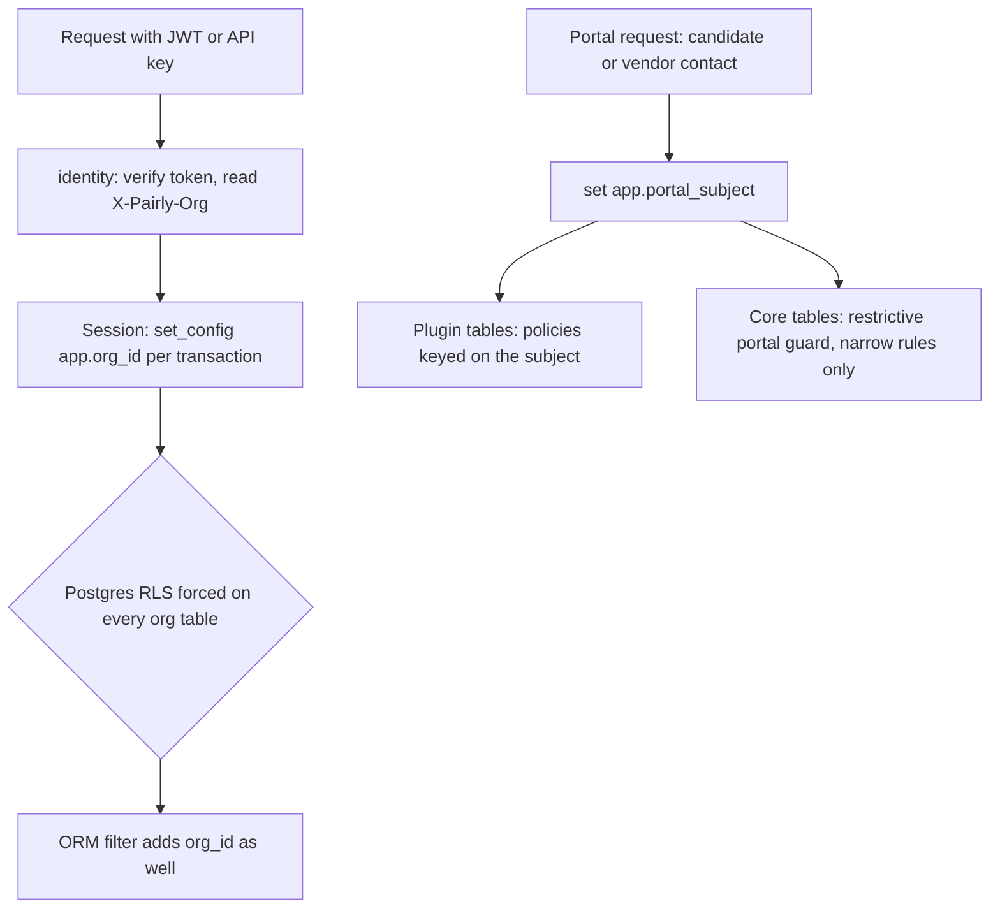
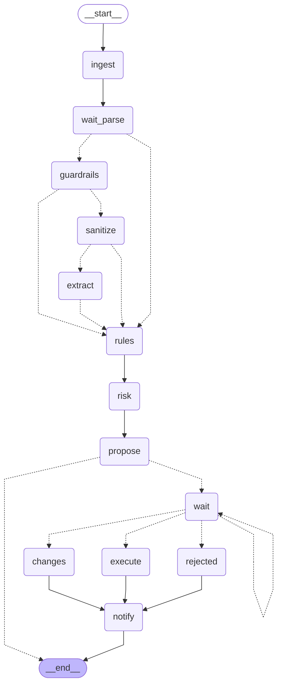
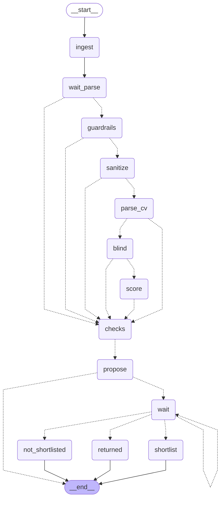
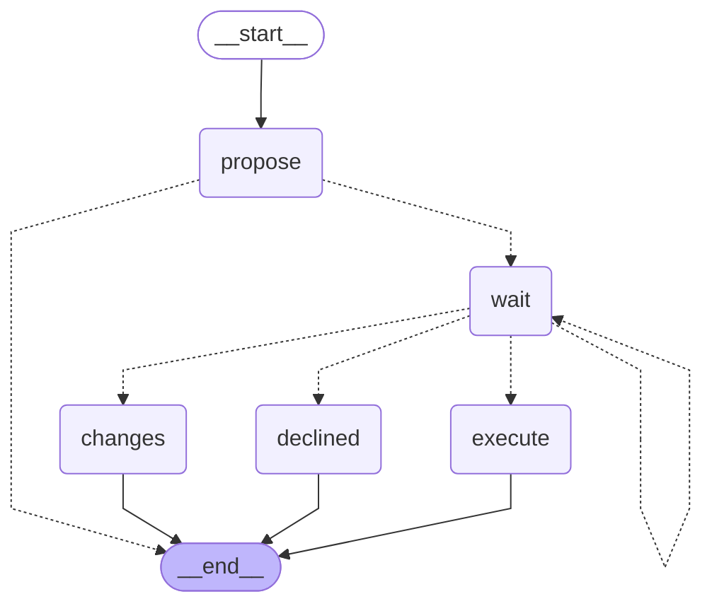
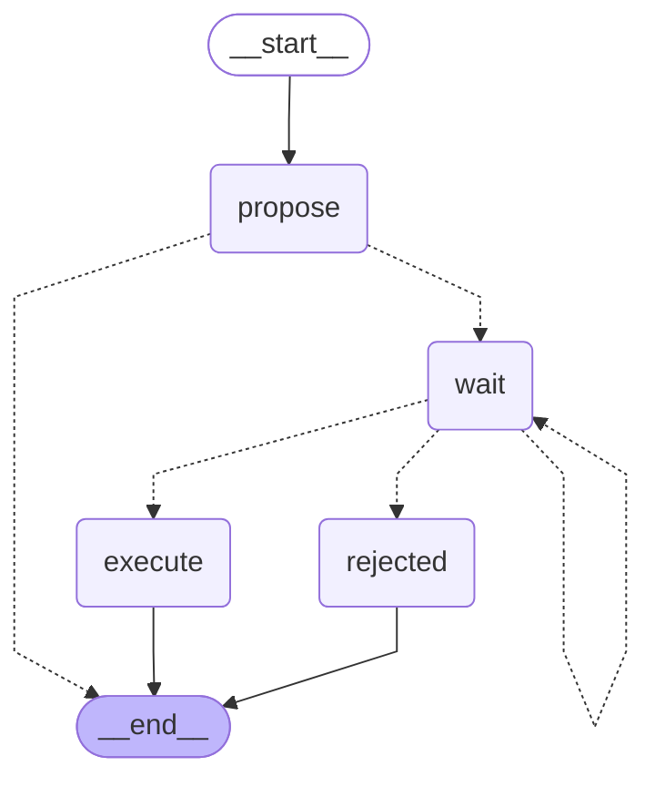
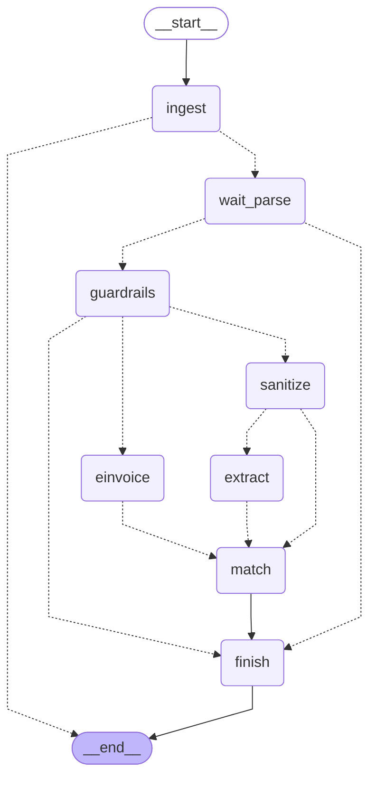
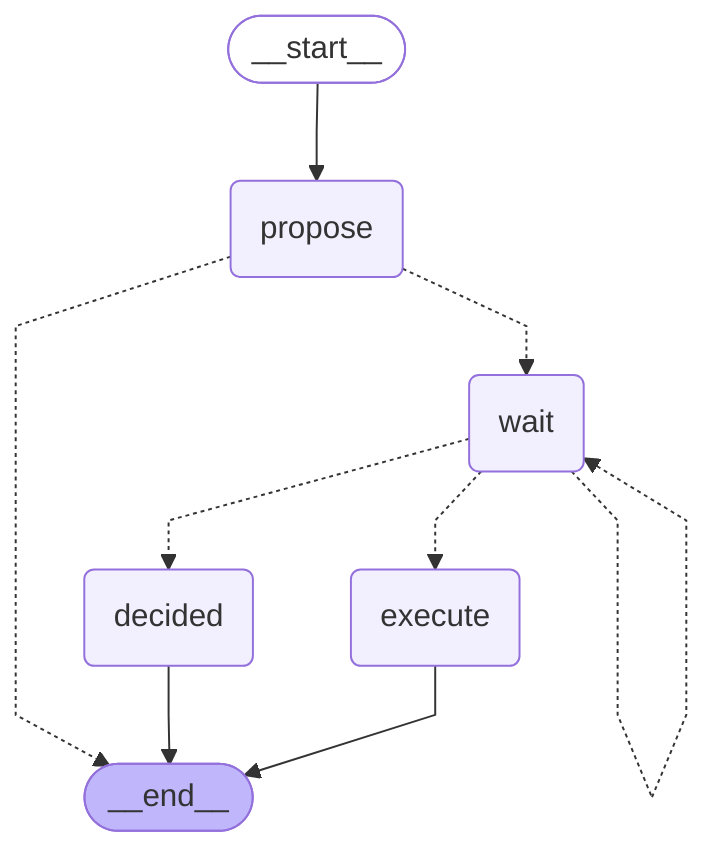

# Architecture

Pairly is one workflow-agnostic engine (`packages/core`, Python package `pairly_core`) and workflow plugins on top of it: Pairly Hire (`packages/hire`), Pairly Pay (`packages/pay`) and a small example, expense notes (`packages/expense`). Two apps run the engine: the API (`apps/api`) and the worker (`apps/worker`). The web app (`apps/web`) and the MCP server (`apps/mcp`) talk to the API over HTTP only.

This page explains how the parts fit. Decisions and their reasons are in the [ADRs](adr/README.md). Security controls are in [security.md](security.md).

## The engine and its modules

```mermaid
flowchart LR
    subgraph apps[Apps]
        web[web: Next.js]
        api[api: FastAPI]
        worker[worker: arq]
        mcp[mcp: read and propose tools]
    end
    subgraph core[pairly_core]
        tenancy[identity, rbac, db: tenancy and RLS]
        ingestion[ingestion]
        documents[documents: sandboxed parsing]
        guardrails[guardrails]
        extraction[extraction]
        policy[policy: rules and RAG]
        risk[risk]
        llm[llm: model router]
        workflow[workflow: LangGraph runtime]
        approvals[approvals and executor]
        decisions[decisions: records, replay, appeals]
        audit[audit and audit_anchor]
        notify[notifications, webhooks]
        more[scheduling, search, retrieval, flags, jobs, retention, dashboards]
    end
    subgraph plugins[Workflow plugins]
        hire[pairly_hire]
        pay[pairly_pay]
        expense[pairly_expense]
    end
    web --> api
    mcp --> api
    api --> core
    worker --> core
    plugins -- entry point pairly.workflows --> core
    core --> pg[(Postgres 16 + pgvector)]
    core --> valkey[(Valkey)]
    core --> store[(Object storage)]
```



| Module | What it does |
|---|---|
| `identity`, `rbac`, `db`, `auth` | Verify the token (Better Auth JWT through JWKS, or an API key), bind the session to one organisation, resolve permissions, enforce the step-up rule |
| `ingestion` | Every way a file enters: upload, API, batch API, inbound email. Hash, sniff, check, dedupe, store, queue the virus scan |
| `documents` | Parse a clean file in a sandboxed subprocess into a `NormalizedDocument` (text blocks with positions, fonts, colours, tables). PDF, DOCX, images and scans (Tesseract) |
| `guardrails` | Deterministic injection detectors, an optional model classifier, sanitising, output validation, PII redaction for logs and traces |
| `extraction` | Schema-driven extraction: every value with a verbatim quote, a location and a confidence |
| `policy` | Versioned YAML rules, and checks against the tenant's own policy documents (retrieval plus the model) |
| `risk` | Pluggable detectors and a combiner that returns a score, a label and evidence |
| `llm` | The model router: providers, cheap tier first, recording and replay, budgets, tracing |
| `workflow` | LangGraph runtime with a tenant-bound Postgres checkpointer, interrupts for human approval |
| `approvals` | Rules, chains, segregation of duties, delegation, SLA, signed links, and the executor that runs final actions |
| `decisions` | Decision records, replay, receipts, appeals, compliance pack export |
| `audit`, `audit_anchor` | The hash-chained audit log, signed chain heads outside the database, chain verification |
| `notifications`, `webhooks` | Email, Slack and in-app messages from templates; signed outbound webhooks with retries; deduplicated inbound events |
| `scheduling`, `search`, `retrieval`, `flags`, `jobs`, `retention`, `dashboards`, `proposals`, `batches`, `crypto`, `api_keys` | The other shared services each workflow can use |

The engine never imports a workflow, and the apps never import one either. Both rules are import-linter contracts in `pyproject.toml` (`make lint` runs them).

## The plugin contract

A workflow is a Python package that registers one object under the `pairly.workflows` entry point. The API, the worker, the MCP server and the Alembic environment all find plugins the same way, at runtime, through `pairly_core.plugins.discover_plugins`. Discovery fails closed: a plugin that does not load or breaks a rule stops the process at startup.

The required part is the `WorkflowPlugin` protocol: `id`, `name`, `permissions` and `graphs`. Everything else is optional and read with `getattr`:

| Attribute | Used by | What it adds |
|---|---|---|
| `graphs` | `pairly_core.workflow.runtime` | `GraphSpec`s: the LangGraph graph, its start and read permissions, its approval types and final actions |
| `api_router` | API | Routes mounted under `/v1/<plugin id>` |
| `migrations_dir` | Alembic | The plugin's own migration branch |
| `prompt_roots` | Model router | Versioned prompts, every task named `<plugin id>_...` |
| `scheduled_jobs` | Worker | Jobs named `<plugin id>_...`, recorded in `job_runs` |
| `document_intake` | Batch API | Turns a submitted document into the workflow's entity and starts its run |
| `dashboard_sections` | Dashboards | Sections on the shared boards (auditor, admin, AI governance), each behind a permission of the plugin |
| `webhook_events`, `feature_flags`, `search_sources`, `retention_rules` | Their registries | Names in the plugin's namespace |
| `demo_seeds` | `pairly-admin seed` | Demo data for one organisation |

Each registry checks that names stay in the plugin's namespace, so a plugin can never replace a core permission, prompt, route or another plugin's.

How the three workflows plug in:

| | Hire | Pay | Expense |
|---|---|---|---|
| Graphs | screening, message, requisition, offer | bank change, invoice, invoice approval, payment run, message | expense note |
| Own prompts | yes | yes | no (uses the core extraction prompt) |
| Document intake | no | yes (invoices) | no |
| Dashboard sections | admin, AI governance | auditor, AI governance | no |
| Portal | candidates | vendor contacts | no |

None of them needed an engine change. The generic extension points were added once, while building the expense example, and are listed in [ADR 0009](adr/0009-generic-workflow-extension-points.md). The step by step guide is [add-a-workflow.md](add-a-workflow.md).

## A document from intake to decision



Each step fails closed. If a scan, a parse, a guardrail, the model or a rule cannot run, the item goes to a person with the reason. Nothing is approved on a failure.

* **Ingestion** (`pairly_core.ingestion`): the same path for every source. The client's file name and type are never trusted. The same bytes sent to two workflows become two documents, so one workflow never learns what another holds.
* **Parsing** (`pairly_core.documents.sandbox`): the parser runs in a separate subprocess with resource limits, after a clean scan.
* **Guardrails before any model** (`pairly_core.guardrails`): `scan_document` runs deterministic detectors (hidden text, tiny fonts, instruction phrases in English and Arabic, metadata, unusual Unicode, keyword stuffing). `sanitize_for_model` removes flagged spans and wraps the rest in a nonce-delimited data block. `extract` only accepts a `GuardedInput` built from that report.
* **Model calls** go through the router only (see below). The output is validated against a Pydantic schema; evidence quotes must exist in the text the model saw.
* **A person decides.** `request_approval` and `await_decision` interrupt the graph. `resume_run` is the only way to resume, and only after a decision is stored. The executor re-checks the approval from the database before any final action (`pairly_core.approvals.executor`).

The exported graph of each workflow is at the end of this page.

## Tenancy



* **Row Level Security** is the boundary. Every org-scoped table has RLS enabled and forced, with a policy on `app_current_org_id()`. With no organisation set, policies match no rows. The application role owns no table and cannot bypass RLS; the worker and the API refuse to start with a role that can (`pairly_core.db.check_app_role`). The ORM adds the same filter as a second layer.
* **Portal subjects**: candidates and vendor contacts are not staff. A portal session also sets `app.portal_subject` (`hire_candidate:<uuid>` or `pay_vendor:<uuid>`). Plugin tables key restrictive policies on it.
* **The portal guard** (core migrations `0022` and `0023`): every org-scoped core table, and every plugin table without its own portal policy, gets restrictive per-command policies. While a portal subject is set the table shows nothing and accepts nothing, except narrow rules in `portal_guard_rules`. Details and the full rule table are in [security.md](security.md#portal-sessions).
* **Workflow checkpoints** live in their own schema with RLS, and the thread id embeds the organisation (`pairly_core.workflow.checkpoint`).
* **Cross-tenant work** (jobs that visit every organisation, link lookups) goes through narrow SECURITY DEFINER functions that return ids only. The job then works in each organisation under RLS.

## Audit chain and anchors

Every organisation has its own chain in `audit_events` (`pairly_core.audit`). Each event stores the hash of the previous one:

```
hash = sha256( bytes.fromhex(prev_hash) || canonical_event_json(event) )
```

* `append_audit` is the only writer. It takes a per-organisation advisory lock, so concurrent writers still form one chain. The event commits with the change it records.
* The database rejects UPDATE, DELETE and TRUNCATE on `audit_events` for every role, and an insert trigger rejects a row that does not link to the end of its chain.
* Removing the newest events would leave a shorter chain that still links. To catch that, a nightly job signs each chain head with an Ed25519 key that is not in the database and writes it to write-once object storage (`pairly_core.audit_anchor`). Verification fails when the chain no longer holds an anchored head (`anchor_mismatch`) or ends before one (`anchor_truncated`).
* Payloads hold ids and short facts, never document contents or secrets; `append_audit` refuses keys that look like secrets.

## Decision records and replay

Every AI-assisted step and every human action on it becomes a decision record with a stable `dec_...` id (`pairly_core.decisions`). A record holds the exact inputs (document hashes, extracted fields), the policy and rubric versions, the model and prompt versions, the output with its confidence and evidence, and, for a person's action, who did what and why. Sensitive parts are encrypted. A later record can supersede an earlier one (a human override), so the chain of one decision is a query.

Replay (`pairly_core.decisions.replay`) re-runs a decision from its record without changing it:

1. it checks the record is intact (decrypts, content hash, audit chain);
2. it re-runs every stored model call through `ModelRouter.replay`, from the recorded response by default or from the live model on request;
3. it re-evaluates the deterministic part (rules, risk combiner, extraction parsing, and handlers a workflow registers, such as Hire's score aggregation) from the stored inputs and policy version;
4. it stores a `decision_replays` row: `match`, `differs` with a field level diff, or `failed` with a reason. Diffs of personal data store fingerprints, never values.

Receipts (a role-redacted page and PDF), appeals with their own queue and SLA, and the compliance pack export are built on the same records.

## Model router

All model calls go through `ModelRouter.complete` (`pairly_core.llm.router`). It returns a validated instance of the caller's schema or raises `ModelUnavailable`, which callers turn into a human queue item.

* **Cheap first.** A task starts at its prompt's tier (`small` or `large`) and escalates on invalid output or low confidence, up to the task's `max_tier`. Within a tier, providers are tried in catalog order (`llm/data/models.yaml`).
* **Prompts** are versioned files (`<task>/<version>.md`) with front matter: tier, temperature 0, output schema. The body is sent as is, with no templating; caller data goes in the user message as JSON. Every call records the prompt version and the SHA-256 of the file.
* **Modes** (`PAIRLY_MODEL_MODE`): `live` calls providers and stores every response; `record` does the same and marks the rows as a recording session for bundle export; `recorded` (the default) only replays stored responses, keyed on the exact request, and fails closed when none matches. A recorded response is validated like a live one, so a recorded run makes the same routing decisions. Demos, tests and the offline evals run in `recorded` mode with no API key.
* **Budgets** (`pairly_core.llm.budget`): before each request the worst-case cost is reserved against the organisation's monthly budget, under a per-organisation lock. Over budget, the whole call stops (`BudgetExceeded`). Alerts fire once per month at 80% and 100% of the limit.
* **Logging**: one `model_calls` row per attempt (inputs and output encrypted, tokens, cost, latency, status). LangFuse traces, when configured, get redacted inputs and outputs only; OpenTelemetry spans carry ids and counts, never content.

## Native development stack and Docker

| | Native (`make dev`) | Docker Compose (`make docker-dev`) |
|---|---|---|
| For | development and tests | CI and self-hosting |
| Postgres, Valkey | local processes, data in `.local/` | containers |
| Object storage | filesystem store in `.local/objects` | MinIO |
| Email | files in `.local/mail` | Mailpit |
| Virus scan | a fake scanner that only detects the EICAR test string | ClamAV |

The development replacements are selected by settings that production refuses to load. Both stacks read the same `.env` and run the same database init scripts, so roles and grants are identical. See [infra/README.md](../infra/README.md) and [ADR 0007](adr/0007-native-local-stack.md).

## Workflow graphs

Each graph below is drawn by LangGraph from the code (`uv run python -m scripts.export_graphs`). Solid arrows are fixed edges, dotted arrows are conditional edges. A node named `wait` is the interrupt where a person decides. One file per graph, with its permissions, approval types and final actions, is in [graphs/](graphs/README.md).

<!-- graphs:begin -->

### `expense_note` (Pairly Expense)

Receipt to reimbursable: read, check, and a person decides. [Details](graphs/expense_note.md).



### `hire_screening` (Pairly Hire)

Application to shortlist decision: read, check, score, and a person decides. [Details](graphs/hire_screening.md).



### `hire_message` (Pairly Hire)

A rejection or an offer waits for a person's approval, then is sent. [Details](graphs/hire_message.md).


### `hire_requisition` (Pairly Hire)

A requested role waits for HR (and finance above a budget), then opens. [Details](graphs/hire_requisition.md).



### `hire_offer` (Pairly Hire)

An offer waits for the hiring manager, HR and finance above a threshold. [Details](graphs/hire_offer.md).


### `pay_bank_change` (Pairly Pay)

A verified change of vendor bank details waits for two approvers. [Details](graphs/pay_bank_change.md).



### `pay_invoice` (Pairly Pay)

Read one received invoice and stop at ready or needs review. [Details](graphs/pay_invoice.md).



### `pay_invoice_approval` (Pairly Pay)

An invoice sent for approval waits for the approvers its rules pick. [Details](graphs/pay_invoice_approval.md).


### `pay_payment_run` (Pairly Pay)

A proposed payment run waits for a finance controller. [Details](graphs/pay_payment_run.md).



### `pay_message` (Pairly Pay)

A drafted message to a vendor or requester waits for another person. [Details](graphs/pay_message.md).


<!-- graphs:end -->
