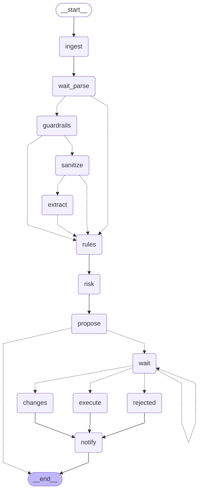

<!-- Generated by `uv run python -m scripts.export_graphs` from the graph code. Do not edit by hand. -->

# `expense_note` (Pairly Expense)

Receipt to reimbursable: read, check, and a person decides.

* Workflow: `expense`, graph version 1.
* Started with `expense.note.submit`, read with `expense.note.read`.
* Approval types: `expense.note`.
* Final actions (run by the engine after a person approves): `mark_reimbursable`.

