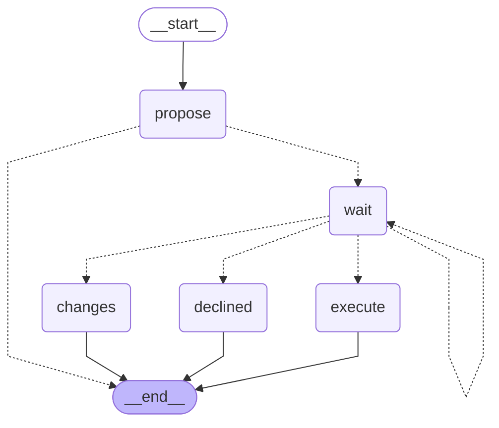

<!-- Generated by `uv run python -m scripts.export_graphs` from the graph code. Do not edit by hand. -->

# `hire_message` (Pairly Hire)

A rejection or an offer waits for a person's approval, then is sent.

* Workflow: `hire`, graph version 1.
* Started with `hire.message.create`, read with `hire.candidate.read`.
* Approval types: `hire.message`.
* Final actions (run by the engine after a person approves): `send_candidate_message`.

