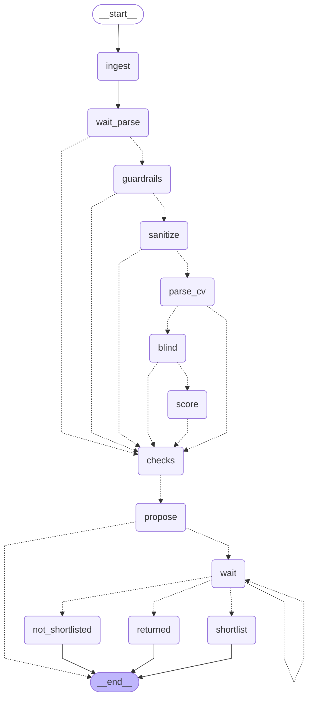

<!-- Generated by `uv run python -m scripts.export_graphs` from the graph code. Do not edit by hand. -->

# `hire_screening` (Pairly Hire)

Application to shortlist decision: read, check, score, and a person decides.

* Workflow: `hire`, graph version 1.
* Started with `hire.screening.propose`, read with `hire.screening.read`.
* Approval types: `hire.screening`.
* Final actions (run by the engine after a person approves): `shortlist`.

