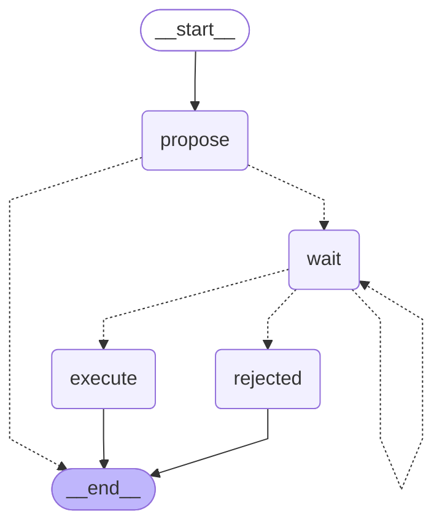

<!-- Generated by `uv run python -m scripts.export_graphs` from the graph code. Do not edit by hand. -->

# `pay_bank_change` (Pairly Pay)

A verified change of vendor bank details waits for two approvers.

* Workflow: `pay`, graph version 1.
* Started with `pay.bank_change.create`, read with `pay.bank_change.read`.
* Approval types: `pay.bank_change`.
* Final actions (run by the engine after a person approves): `approve_bank_change`.

