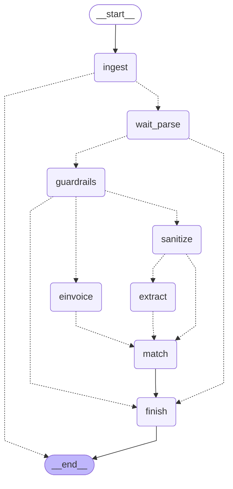

<!-- Generated by `uv run python -m scripts.export_graphs` from the graph code. Do not edit by hand. -->

# `pay_invoice` (Pairly Pay)

Read one received invoice and stop at ready or needs review.

* Workflow: `pay`, graph version 1.
* Started with `pay.invoice.propose`, read with `pay.invoice.read`.
* Approval types: none.
* Final actions (run by the engine after a person approves): none.

