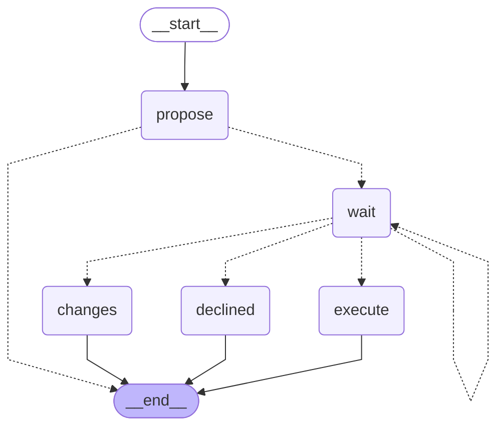

<!-- Generated by `uv run python -m scripts.export_graphs` from the graph code. Do not edit by hand. -->

# `pay_message` (Pairly Pay)

A drafted message to a vendor or requester waits for another person.

* Workflow: `pay`, graph version 1.
* Started with `pay.message.create`, read with `pay.invoice.read`.
* Approval types: `pay.message`.
* Final actions (run by the engine after a person approves): `send_pay_message`.

