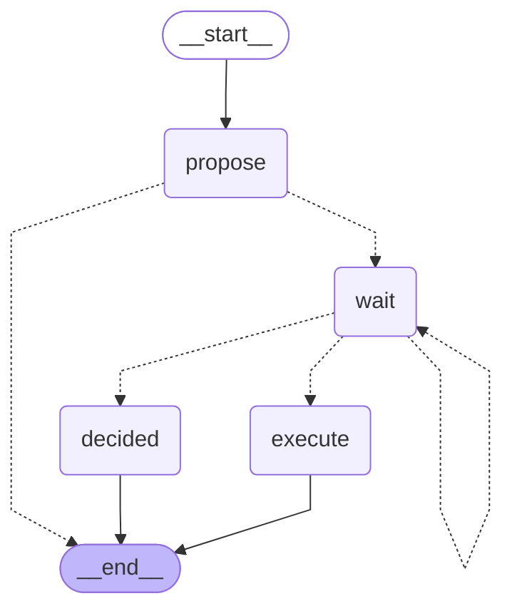

<!-- Generated by `uv run python -m scripts.export_graphs` from the graph code. Do not edit by hand. -->

# `pay_payment_run` (Pairly Pay)

A proposed payment run waits for a finance controller.

* Workflow: `pay`, graph version 1.
* Started with `pay.payment_run.create`, read with `pay.payment_run.read`.
* Approval types: `pay.payment_run`.
* Final actions (run by the engine after a person approves): `approve_payment_run`.

